# Tesla HUD Rive Dashboard

Vehicle-specific **Rive dashboards for [DashPilot](https://github.com/softwiredtech/dashpilot)**,
built around live Tesla telemetry supplied by **[DashKit](https://github.com/softwiredtech/dashkit-firmware)**.

This repository contains dashboard source, reusable visual assets and ready-to-use
`.riv` files. It builds independently and does not require another repository.

## Powered by DashKit

**DashKit is the vehicle-data bridge:** it reads CAN data and sends frames to
DashPilot over Bluetooth Low Energy. DashPilot provides the telemetry to this
dashboard through its `DashViewModel` interface.

The `.riv` file handles presentation; it does not connect to DashKit or decode
CAN messages itself. You need a compatible DashPilot host and DashKit setup for
live vehicle data. Preview images below use demo values.

## Dashboard previews

### Driving — dark mode

Pure-black OLED background, Autopilot-active blue lanes, left turn intent and
occupied blind spots. The left vehicle is red because the matching turn signal
is active; the right vehicle remains grey.

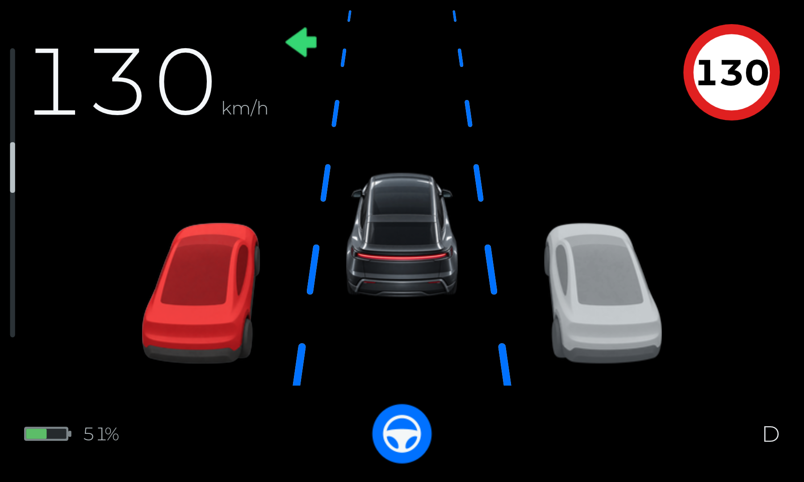

### Driving — light mode

White background with pale neutral road lines and dark speed, gear and battery
text. Autopilot is deactivated in this example.

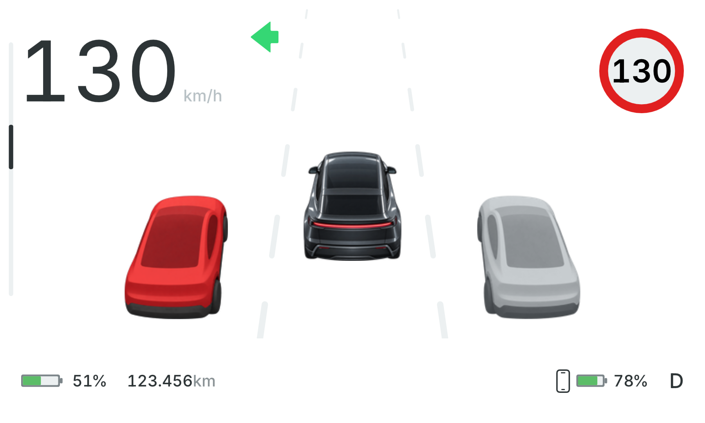

### Park

An enlarged front three-quarter vehicle view replaces the road scene. Current
speed and power/recuperation instruments are hidden.

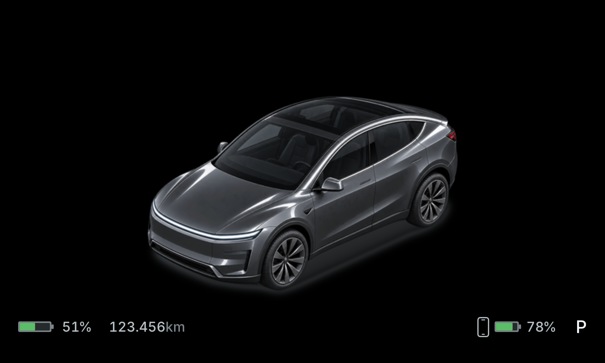

These are actual Rive renderer captures of the included design. To regenerate
them, run `python3 render_previews.py` with the Rive CLI and a graphics context.

## Phone impressions

The current Model Y Juniper Stealth Grey dashboard rendered at each display's
landscape proportions, with illustrative device frames and camera cutouts.
These are mockups, not on-device validation: DashPilot's safe-area handling and
system bars may change the usable display area. The Fold uses its **cover screen
only**, not the unfolded display.

### iPhone 18 Pro Max

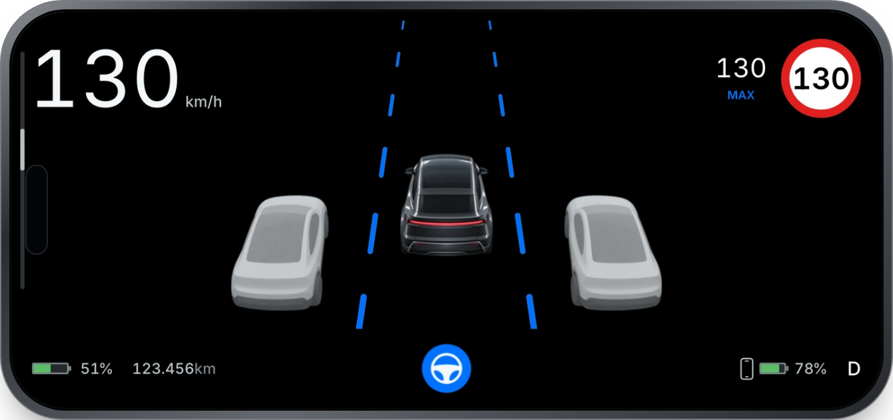

<details>
<summary>Light theme</summary>

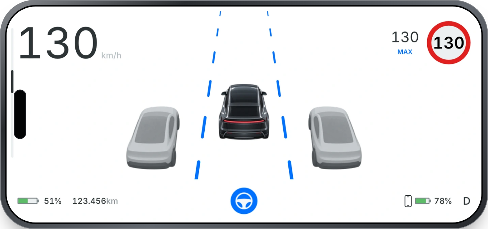

</details>

### Samsung Galaxy S26 Ultra

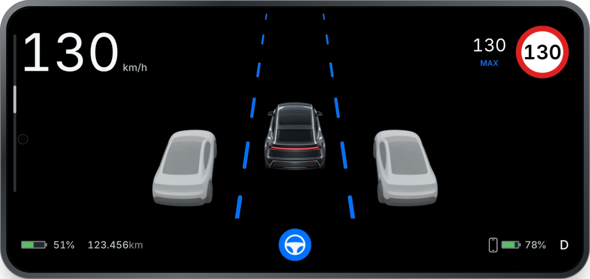

<details>
<summary>Light theme</summary>

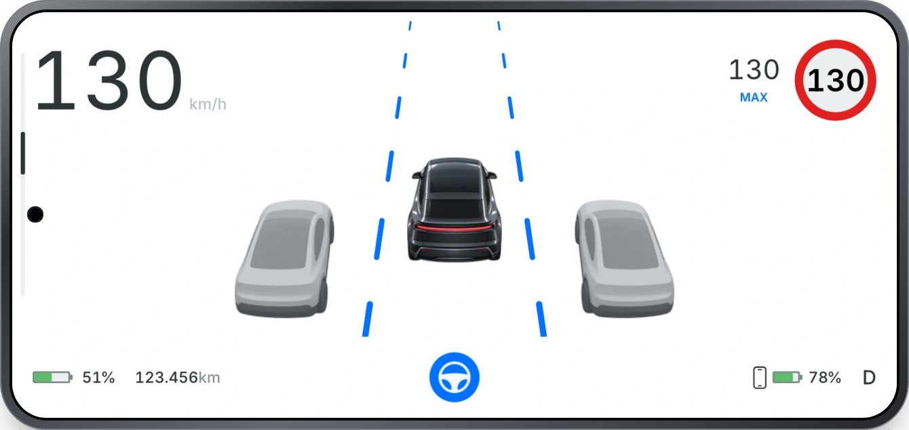

</details>

### Samsung Galaxy Z Fold8 Ultra — cover screen

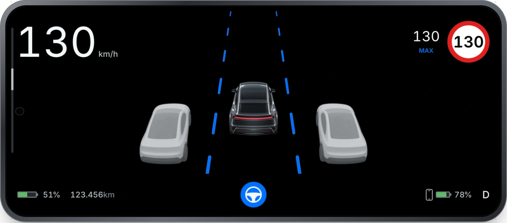

<details>
<summary>Light theme</summary>

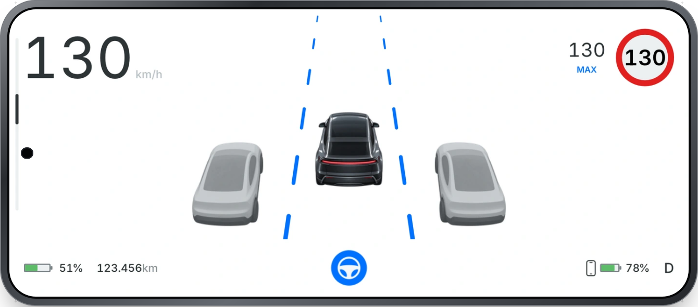

</details>

Display proportions follow the manufacturer specifications for
[iPhone 18 Pro Max](https://www.apple.com/iphone-18-pro/specs/),
[Galaxy S26 Ultra](https://www.samsung.com/hk_en/smartphones/galaxy-s26-ultra/)
and [Galaxy Z Fold8 Ultra](https://www.samsung.com/ch_fr/smartphones/galaxy-z/galaxy-z-fold8-ultra-graphite-256gb-sm-f976bzkbeee/).

## Supported vehicles

- **Model Y Juniper Stealth Grey** — [download dashboard](dashboard/model-y-juniper-stealth-grey.riv).
- **Model Y Juniper White Multi-Coat** — [download dashboard](dashboard/model-y-juniper-white-multi-coat.riv).
- **Model Y Juniper Diamond Black** — [download dashboard](dashboard/model-y-juniper-diamond-black.riv).
- **Model Y Juniper Marine Blue** — [download dashboard](dashboard/model-y-juniper-marine-blue.riv).
- **Model Y Juniper Quicksilver** — [download dashboard](dashboard/model-y-juniper-quicksilver.riv).
- **Model Y Juniper Ultra Red** — [download dashboard](dashboard/model-y-juniper-ultra-red.riv).
- **Model 3 Highland Stealth Grey** — [download dashboard](dashboard/model-3-highland-stealth-grey.riv).
- **Model 3 Highland Pearl White Multi-Coat** — [download dashboard](dashboard/model-3-highland-pearl-white-multi-coat.riv).
- **Model 3 Highland Marine Blue** — [download dashboard](dashboard/model-3-highland-marine-blue.riv).
- **Model 3 Highland Diamond Black** — [download dashboard](dashboard/model-3-highland-diamond-black.riv).
- **Model 3 Highland Ultra Red** — [download dashboard](dashboard/model-3-highland-ultra-red.riv).
- **Model 3 Highland Quicksilver** — [download dashboard](dashboard/model-3-highland-quicksilver.riv).

### Model 3 Highland Stealth Grey

The same dashboard and telemetry bindings, with dedicated elevated rear Drive
and front three-quarter Park artwork. Blind-spot cars remain shared.


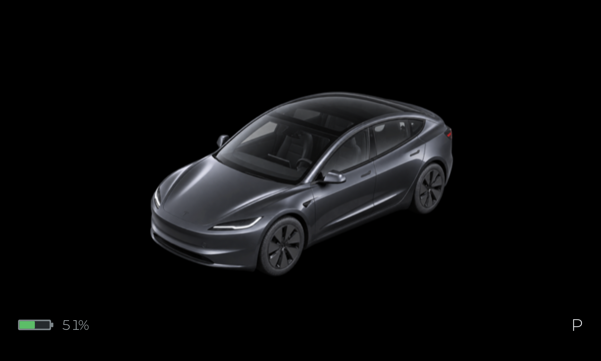

### Additional Model 3 Highland colors

All colors share the same Highland Park/Drive angles, telemetry bindings,
original vector turn signals and generic blind-spot cars. Each `.riv` embeds
only its selected vehicle's artwork.

| Color | Park preview | Drive preview |
| --- | --- | --- |
| Pearl White Multi-Coat | [Park](docs/images/model-3-highland-pearl-white-multi-coat/park-dark.png) | [Dark](docs/images/model-3-highland-pearl-white-multi-coat/drive-dark.png) / [Light](docs/images/model-3-highland-pearl-white-multi-coat/drive-light.png) |
| Marine Blue | [Park](docs/images/model-3-highland-marine-blue/park-dark.png) | [Dark](docs/images/model-3-highland-marine-blue/drive-dark.png) / [Light](docs/images/model-3-highland-marine-blue/drive-light.png) |
| Diamond Black | [Park](docs/images/model-3-highland-diamond-black/park-dark.png) | [Dark](docs/images/model-3-highland-diamond-black/drive-dark.png) / [Light](docs/images/model-3-highland-diamond-black/drive-light.png) |
| Ultra Red | [Park](docs/images/model-3-highland-ultra-red/park-dark.png) | [Dark](docs/images/model-3-highland-ultra-red/drive-dark.png) / [Light](docs/images/model-3-highland-ultra-red/drive-light.png) |
| Quicksilver | [Park](docs/images/model-3-highland-quicksilver/park-dark.png) | [Dark](docs/images/model-3-highland-quicksilver/drive-dark.png) / [Light](docs/images/model-3-highland-quicksilver/drive-light.png) |

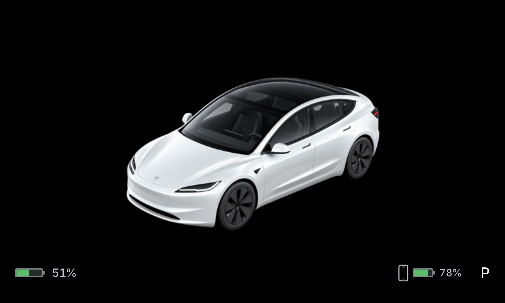

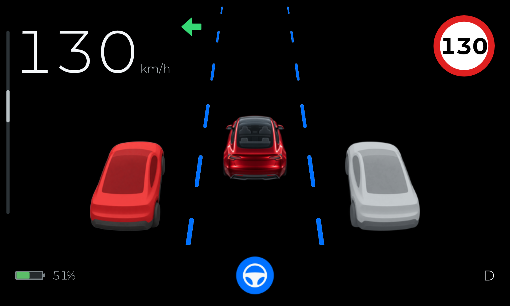

### Model Y Juniper White Multi-Coat

White Multi-Coat Park and Drive artwork, with the same layout and shared
blind-spot vehicles as the other designs.

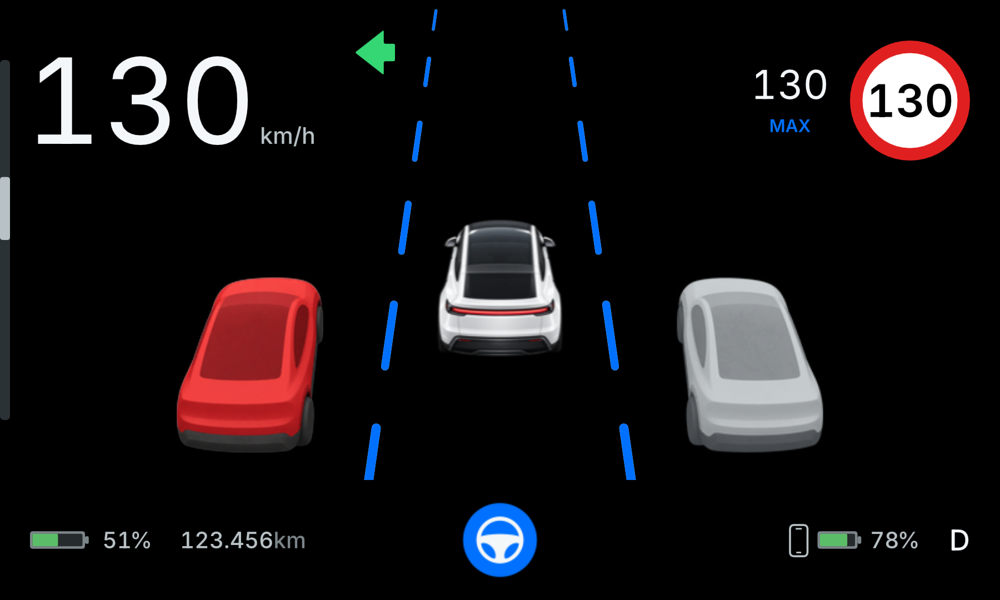

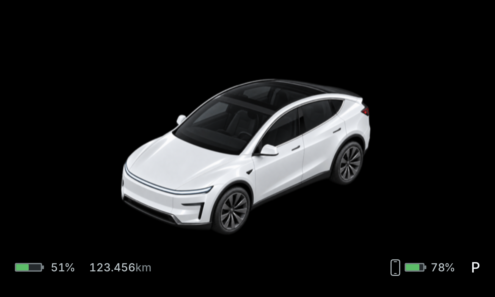

### Model Y Juniper Diamond Black

Diamond Black Park and Drive artwork with the same shared dashboard layout,
telemetry bindings and blind-spot vehicles.

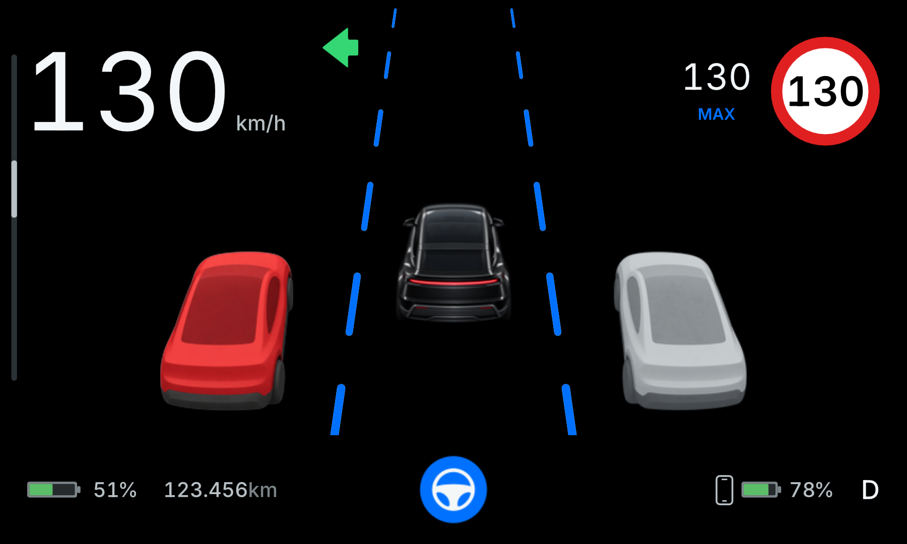

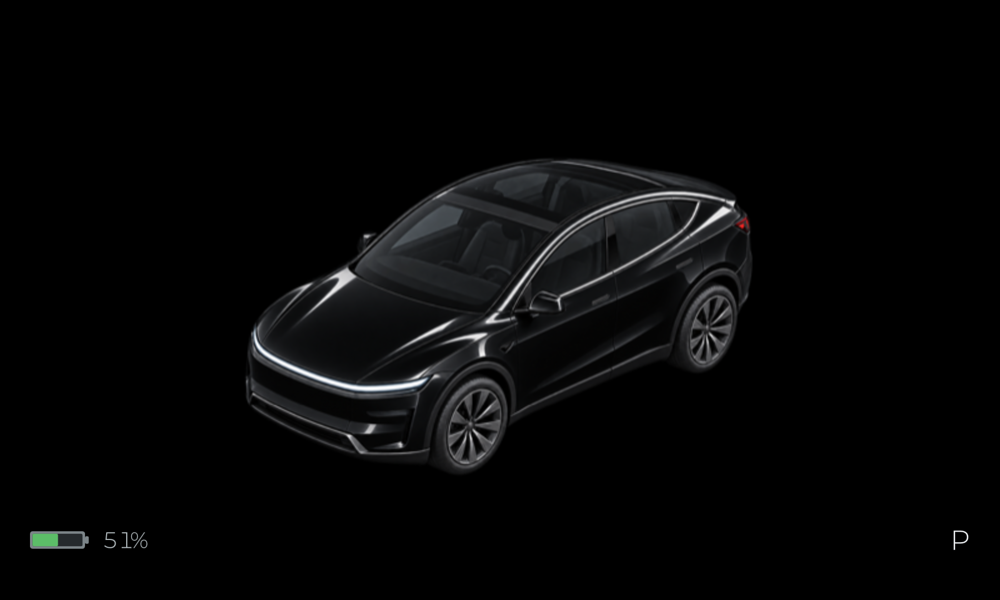

### Model Y Juniper Marine Blue

Marine Blue Park and Drive artwork with the same shared dashboard layout,
telemetry bindings and blind-spot vehicles.

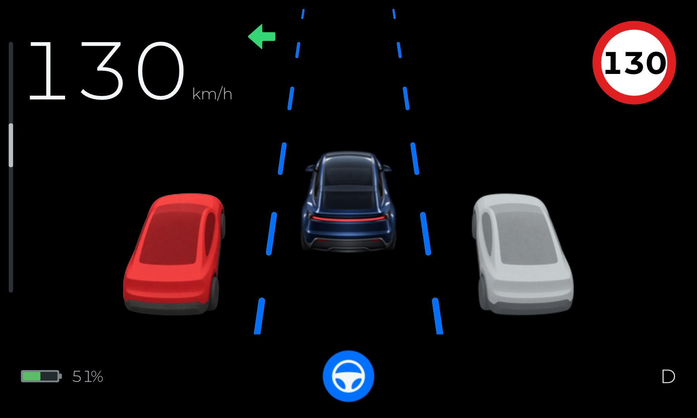

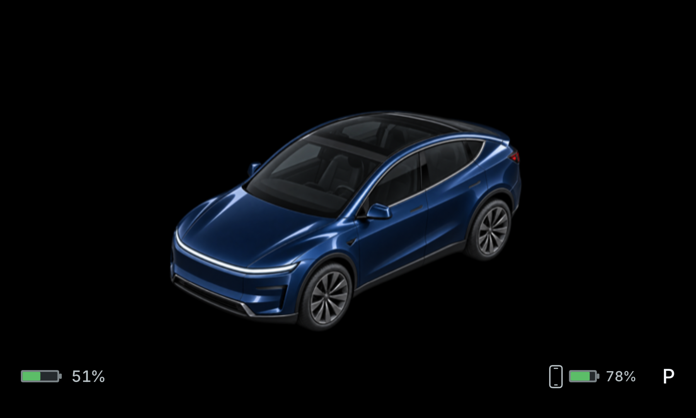

### Model Y Juniper Quicksilver

Quicksilver Park and Drive artwork with the same shared dashboard layout,
telemetry bindings and blind-spot vehicles.

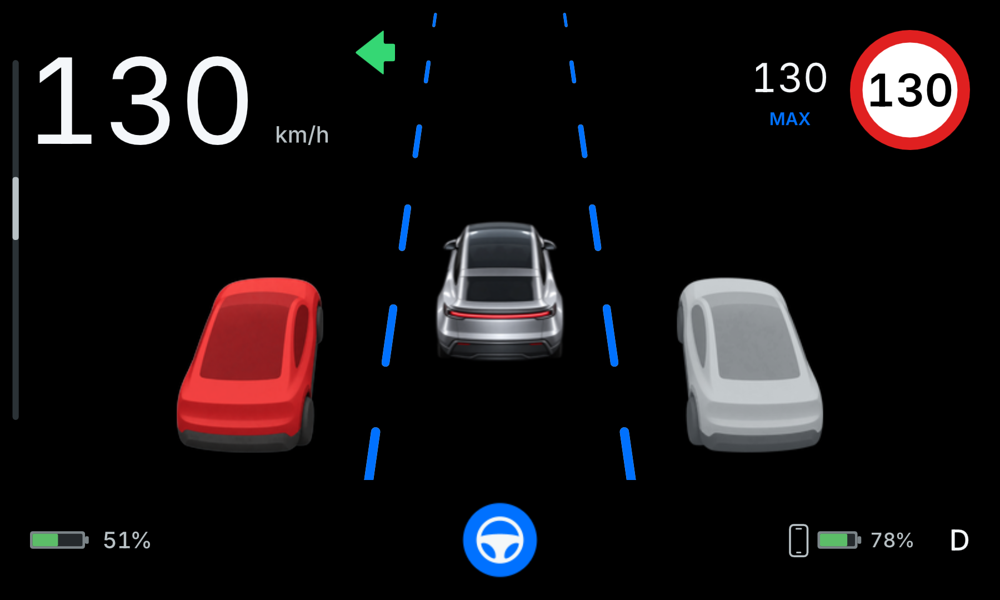

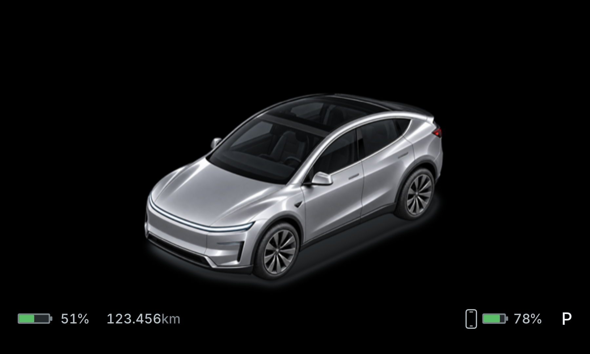

### Model Y Juniper Ultra Red

Ultra Red Park and Drive artwork with the same shared dashboard layout,
telemetry bindings and blind-spot vehicles.

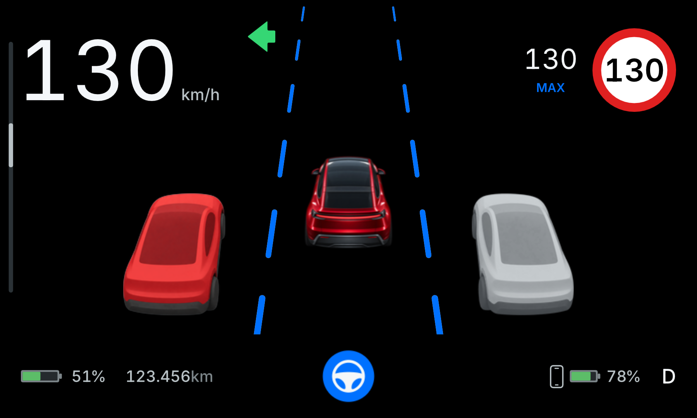

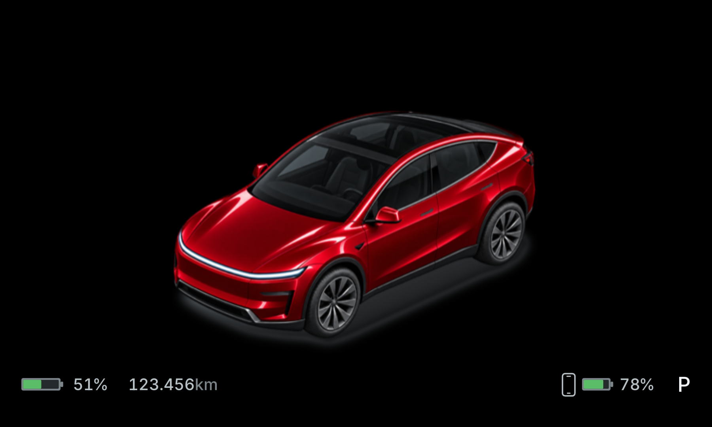

This list describes the vehicle artwork currently included in this repository,
not a complete DashKit hardware-compatibility list.

## Where to find the `.riv` files

Ready-to-use dashboard files live in **[`dashboard/`](dashboard/)**, named after
their vehicle design:

```text
dashboard/
├── model-y-juniper-stealth-grey.riv
├── model-3-highland-stealth-grey.riv
├── model-y-juniper-white-multi-coat.riv
├── model-y-juniper-diamond-black.riv
├── model-y-juniper-marine-blue.riv
├── model-y-juniper-quicksilver.riv
├── model-y-juniper-ultra-red.riv
├── model-3-highland-pearl-white-multi-coat.riv
├── model-3-highland-marine-blue.riv
├── model-3-highland-diamond-black.riv
├── model-3-highland-ultra-red.riv
└── model-3-highland-quicksilver.riv
```

Open the desired file on GitHub and use **Download raw file** to save it, then
load it through your DashPilot host's Rive-dashboard support. The export embeds
its fonts and images; no separate asset download is needed for playback.

You can also download dashboard artifacts from the repository's **Actions** tab
after a successful Dashboard CI run. Generated intermediate files under
`build/` are not the distributable dashboard collection.

## Features

- Responsive left/right instruments with a centered road scene and Autopilot.
- Current speed, European speed-limit sign, selected gear and battery percentage.
- Car battery on the left and phone battery beside the gear on the right, with
  a phone icon; phone visibility follows DashPilot's `showPhoneBattery` setting.
- Odometer beside the car battery: `123.456km`, with a muted km suffix.
- Power-consumption and green recuperation indicators.
- Speed-dependent road animation and blue lanes while Autopilot is active.
- Cruise set speed with a blue MAX caption beside the speed limit while assist
  is active. Inter Regular for speed values, Medium for labels and SemiBold
  for the speed-limit digits and MAX caption.
- Bright/dim turn-signal phases and shared grey/red blind-spot vehicles.
- Separate Park and Drive car views, plus stopped D/R direction arrows with a
  0.4-second departure movement/fade.
- Host-controlled light/dark themes; dark is the default with a true-black
  `#000000` background.

## Build and contribute

Requires Python 3 and **Rive CLI 1.6.0**. From the repository root:

```sh
python3 build.py
python3 -m unittest discover -s . -p 'test_*.py'
```

The build exports every supported vehicle into `dashboard/` and enforces a
5 MB limit per export. To build only the Highland, run
`python3 build.py --vehicle model-3-highland-stealth-grey`.
GitHub Actions performs the same checks and publishes
the `.riv`, generated RML and SHA-256 checksum as build artifacts.

Model-specific `park.png` and `drive.png` live in
`assets/vehicle/<vehicle-design>/`. Blind-spot cars and indicator
icons stay shared under `assets/` for reuse across vehicle designs.

See [Development](docs/DEVELOPMENT.md) for setup, preview generation, responsive
layout, data bindings and runtime checks.

## Project status and credits

This dashboard is still in development, not a phone-validated contest release.
The km/h-versus-mph road-playback comparison remains unresolved; see the
[validation report](VALIDATION.md) before relying on runtime behavior.

Vehicle and icon provenance is documented in [CREDITS.md](CREDITS.md).
Inter fonts include their [SIL Open Font License](fonts/Inter-OFL.txt).
Turn-signal arrows are original vector geometry, not downloaded Tesla artwork.
Check the credits for vehicle artwork provenance before redistributing or
submitting a contest entry.
